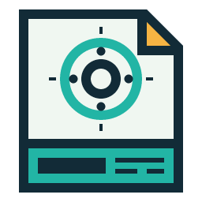

# CADCraftGOST

Открытый форк [CADCraft](https://github.com/storytold/cadcraft) для машиностроительных
чертежей и документации по ЕСКД. Независимый проект; не продукт ArtCraft или АСКОН.
Исходный CADCraft создан ArtCraft Team и сообществом; авторские уведомления сохранены.

<p align="center">
  
</p>

- [Полный план разработки](ROADMAP.md), [проверки и открытые ограничения](PROGRESS.md).
- [Руководство ГОСТ и нормативные источники](docs/gost.md).
- [Архитектура](ARCHITECTURE.md), [исследование интеграции SolidCraft](docs/solidcraft-reuse.md).
- [Подходящие функции КОМПАС-3D и критерии их реализации](docs/kompas-comparison.md).
- [Исходный код и поддержка](https://github.com/mikiway902/russian-cadcraft).
- [Сборки и выпуски форка](https://github.com/mikiway902/russian-cadcraft/releases).

Проект в разработке. Наличие рамки, ГОСТ-шрифта или чистого автоматического отчёта
не удостоверяет полное соответствие ЕСКД. Точная интеграция с SolidCraft и весь новый
roadmap ещё не приняты; старый семиэтапный план не является их подтверждением.

Далее описаны возможности унаследованного 2D-приложения и действующие инструменты
форка. Cargo-пакеты и build targets (`cadcraft`, `cadcraft-cli`) — внутренние имена
workspace. Установленные программы: `cadcraftgost` и `cadcraftgost-cli`; они не
заменяют программы оригинального CADCraft.

## Screenshots

<table>
  <tr>
    <td width="50%"></td>
    <td width="50%"></td>
  </tr>
  <tr>
    <td><sub><b>Layouts</b>: paper space with viewports, page setups and PLOT to PDF. Double-click a viewport to work in model space through it.</sub></td>
    <td><sub><b>Mounting bracket</b>: a two-view part drawing with centre lines, hidden lines, an ANSI31 section hatch and a title block.</sub></td>
  </tr>
</table>

## Why CADCraft

- **The workflow you know.** Type `L`, click two points, type `@5<45`, press Enter. The command
  line, prompts with clickable `[Keywords]`, AutoComplete, object snaps, polar tracking, ortho,
  direct distance entry, window and crossing selection, grips, and right-click-to-repeat behave
  the way decades of drafting habit expect.
- **Open files.** DXF is read and written natively (ASCII and binary, R12 through 2018), and DWG
  files (R13 through 2018) open and save through the open-source acadrust library. Export to SVG
  and PNG today.
- **Fast and native.** Pure Rust and egui, no Electron, no web view. One binary on macOS
  (universal), Windows, Linux and FreeBSD, plus a WebAssembly build for the browser.
- **Built for agents.** Every menu item, tool and prompt is a command. Agents can type at the
  command line exactly like a person, call any command with JSON, inspect the drawing to verify
  their work, and render it — over MCP, a JSON control channel, or the CLI.
- **Free.** MIT OR Apache-2.0, with no account and no subscription.

## What works today

Унаследованное ядро CADCraft и инструменты форка продолжают развиваться.
Фактическая приёмка каждого нового этапа фиксируется в [PROGRESS.md](PROGRESS.md).

| Area | Status |
|---|---|
| Drawing area | Model space with adaptive grid, axes, pan/zoom (wheel, middle-drag, pinch), crosshair cursor with pickbox, UCS icon, ViewCube, viewport label |
| Command line | Prompts with keywords, history, AutoComplete, aliases, `@dx,dy`, `@d<a`, `#x,y`, direct distance entry, Enter/space/right-click to repeat, transparent commands, `.scr`-style scripts |
| Draw | LINE, PLINE (arcs, widths), CIRCLE (center/radius/diameter, 2P, 3P), ARC, RECTANG (fillet/chamfer), POLYGON, ELLIPSE (+arcs), SPLINE, POINT, XLINE, RAY, DONUT, TEXT, MTEXT |
| Modify | ERASE, MOVE, COPY, ROTATE, SCALE, MIRROR, STRETCH, OFFSET, TRIM, EXTEND, FILLET, CHAMFER, BREAK, JOIN, EXPLODE, rectangular/polar ARRAY, draw order, OVERKILL |
| Precision | Object snaps (endpoint, midpoint, center, geometric center, node, quadrant, intersection, insertion, perpendicular, tangent, nearest; deferred tangent/perpendicular for the first point of a line, e.g. belt lines tangent to two circles), polar tracking, ortho, grid snap |
| Layers & properties | Layers palette and Layer Properties Manager (on/off, freeze, lock, plot, colour, linetype), layer tools (isolate, freeze, off, lock, match, previous), Properties palette with per-object editing, linetypes, lineweights, colour index and true colour |
| Annotation | All DIM* commands with full DIMSTYLE variables, overrides and every arrowhead, associative dimensions that follow geometry, MLEADER, TABLE, TrueType fonts (`.ttf`, `.otf`, `.ttc` collections), MTEXT formatting codes (fonts, heights, colours, stacked fractions), our own single-stroke drafting font |
| Hatch & blocks | Pick-point hatch boundaries with islands, pattern, solid and gradient fills from our own pattern library, BLOCK/INSERT, attributes and nested blocks |
| Files | DXF read (R12–2018, ASCII and binary) and write (R2000), including dimension styles, associativity, tables and constraints; DWG read (via the acadrust library) and write (R2000); PDF plotting, SVG and PNG export. Unsupported or damaged data can be skipped; inspect read warnings before saving. See [file-format parity](docs/file-format-parity.md) |
| Layouts & plotting | Paper-space layouts, viewports (scale, lock, per-viewport layer freeze), MSPACE/PSPACE through viewports, page setups, PLOT and EXPORTPDF |
| Parametric | Geometric and dimensional constraints, AUTOCONSTRAIN, PARAMETERS with expressions, conflict detection; constraints re-solve after every edit |
| Grips | Hot grips with Space to cycle Stretch, Move, Rotate, Scale and Mirror |
| Interface languages | English, Ukrainian (Українська), Brazilian Portuguese (Português (Brasil)), German (Deutsch), Spanish (Español), Czech (Čeština), Russian (Русский), French (Français), Simplified Chinese (简体中文, with an installed CJK font), Italian (Italiano), Korean (한국어, with an installed Hangul font), Swedish (Svenska), Arabic (العربية, with an installed Arabic font), Hungarian (Magyar), Turkish (Türkçe), Greek (Ελληνικά), Bosnian (Bosanski) and Georgian (ქართული), live switching and a remembered Auto/system-language choice; [details](docs/localization.md) |
| Automation | MCP server, JSON control channel, `cadcraftgost-cli` (info, convert, run, commands, mcp) |

## Quick start

CADCraftGOST requires Rust 1.95 or later.

```sh
git clone https://github.com/mikiway902/russian-cadcraft
cd russian-cadcraft
cargo run --release -p cadcraft -- --sample       # opens the sample drawing
```

Then try typing at the command line:

```text
line 0,0 @10,0 @0,5 c          a closed triangle
circle 5,2 1                    a circle
offset 0.25                     then pick the circle and a side
zoom e                          zoom to extents
```

The web build: `cd apps/cadcraft-web && trunk serve` (needs [trunk](https://github.com/trunk-rs/trunk)).

### Оформление по ГОСТ / ЕСКД

Новые документы по умолчанию: миллиметры, профиль ЕСКД, встроенный OpenGost Type B,
размеры с десятичной запятой и лист A4 с рамкой и основной надписью.
Основано на CADCraft; открытые файлы и пользовательские шаблоны автоматически не изменяются.

Меню **Формат → ГОСТ / ЕСКД**: листы A4–A0, общие реквизиты и нумерация книги,
основные надписи форм 1/2/2а, ассоциативные осевые, инженерные обозначения,
технические требования, многостраничные спецификации и номера позиций.
Виды и плоские разрезы строятся из замкнутых многогранных 3D-тел;
изменение источника перестраивает изображения и привязанные размеры.
Нормоконтроль проверяет поддерживаемую геометрию с переходом к объекту.
Команды, параметры и связи доступны также через CLI/MCP и сохраняются в DXF.

Это средства оформления, а не удостоверение полного соответствия ГОСТ
или полная замена ядра КОМПАС-3D. Шрифт, содержание и области вне автоматической
проверки требуют контроля конструктора.
[Инструкция, нормативные источники и ограничения](docs/gost.md) ·
[Выполненный план и приёмка](docs/gost-roadmap.md).

### Fonts

CADCraftGOST embeds unmodified OpenGost Type B under SIL OFL 1.1 for offline ESKD
lettering. Other installed TrueType/OpenType fonts remain available. Builds made with the optional [craft-fonts](https://github.com/storytold/craft-fonts)
input (`CRAFT_FONTS_DIR=<absolute path to a checkout> cargo build --release`) also embed its
fonts: BIZ UDPGothic, BIZ UDMincho and Shippori Mincho (Japanese) and Noto Sans Arabic (the web
build, which has no system fonts, only BIZ UDPGothic Regular and Noto Sans Arabic). A text style
can use them by family name, and they draw characters a text's font lacks when no installed
wide-coverage CJK font has them. Without `CRAFT_FONTS_DIR`, OpenGost is still embedded. SHX
fonts (including big fonts such as `chineset.shx`) aren't read yet: text in an SHX style is drawn
with our own stroke font, and any character a text's font lacks (CJK, for example) is drawn from
an installed font that has it, preferring wide-coverage fonts such as Noto Sans CJK, Source Han
Sans, WenQuanYi, PingFang or Microsoft JhengHei. Two settings, set with `SETVAR` or (for every
run) an environment variable, steer this:

| Variable | Environment | Meaning |
|---|---|---|
| `FONTALT` | `CADCRAFT_FONTALT` | Font used instead of a text style font that can't be found (an SHX file, a missing TTF), by file or family name, e.g. `Noto Sans CJK TC`. Empty (default) = our stroke font. |
| `FONTFALLBACK` | `CADCRAFT_FONTFALLBACK` | Fonts tried first for characters a text's font lacks, comma-separated, e.g. `Noto Sans CJK TC, msjh.ttc`. |

`.` clears either one.

**Your own fonts.** Any `.ttf`, `.otf` or `.ttc` font works: install it in the system font folder
(Windows `C:\Windows\Fonts` or per-user fonts, macOS `/Library/Fonts` or `~/Library/Fonts`,
Linux and the BSDs `/usr/share/fonts`, `/usr/local/share/fonts`, `~/.local/share/fonts` or
`~/.fonts`) and name it in a text style (`STYLE`, or `style {"name":"FA","font":"Vazirmatn"}`)
by file name (`Vazirmatn-Regular.ttf`) or family name (`Vazirmatn`), or inline in MTEXT with
`\fVazirmatn;`. Restart CADCraft after installing a font: the font folders are scanned once.

**Right-to-left text (Persian, Arabic, Urdu, Hebrew).** TEXT and MTEXT lines are laid out with the
Unicode Bidirectional Algorithm (the paragraph direction comes from its first letter, so numbers
and Latin words inside Persian text keep their own order), and Arabic-script text is shaped with
OpenType (contextual letter forms, lam-alef and other ligatures, ZWNJ / ZWJ, mark positioning).
Justification (left, centre, right, MTEXT attachment and wrapping) still refers to the text's box.
Our stroke font has no Arabic letters, so Persian in a stroke-font style is drawn from an
installed font that has them: Vazirmatn, Noto Naskh Arabic, Noto Sans Arabic, Segoe UI, Tahoma,
Arial and DejaVu Sans are looked for first. To choose the font, install a free Persian font such
as [Vazirmatn](https://github.com/rastikerdar/vazirmatn) (SIL Open Font License) and either use it
in the text style or set `FONTFALLBACK` (`CADCRAFT_FONTFALLBACK="Vazirmatn"`). Formatting changes
inside a word (an MTEXT colour change in the middle of a Persian word) break the joining at that
point.

### Logs

The desktop app writes its `log` records to standard error and to `logs/cadcraftgost.log` in the
settings directory (Linux and the BSDs `~/.config/cadcraftgost/logs/`, or
`$XDG_CONFIG_HOME/cadcraftgost/logs/`; macOS
`~/Library/Application Support/io.github.mikiway902.cadcraftgost/logs/`; Windows
`%APPDATA%\io.github.mikiway902.cadcraftgost\logs\`; or under `CADCRAFT_CONFIG_DIR`).
A start from a desktop menu or the Dock has no terminal, so this file is what to attach
to a bug report. Previous logs are `cadcraftgost.1.log` and `cadcraftgost.2.log`.
The file stops growing at 16 MiB. `--version` writes no file.

| Variable | Effect |
|---|---|
| `CADCRAFT_CONFIG_DIR` | Use this directory instead of the platform settings directory (the log goes to its `logs/`); empty means no settings folder (no log file, autosave, workspace or plotters) |
| `RUST_LOG` | Log levels for standard error and the log file. Default: `info` for CADCraft's own crates, `warn` for everything else. env_logger-style directives replace that, e.g. `RUST_LOG=debug`, `RUST_LOG=warn,cadcraft_io=trace` or `RUST_LOG=info,wgpu_core=warn`; a directive ending in `*` covers every target starting with it (`cadcraft*=debug`). `cadcraft_engine=debug` also logs every command-line message. |

The logger is `apps/cadcraft/src/logging.rs`; the web build logs to the browser console instead.

## Drive it from agents, MCP and the CLI

```sh
# MCP server on stdio, headless:
cadcraftgost-cli mcp
# …or bridged to the running app (start it with --control 7979):
cadcraftgost-cli mcp --connect 127.0.0.1:7979

# One-shot headless runs:
cadcraftgost-cli run --sample --script 'CIRCLE 22,3 1\n' --save out.dxf --export out.png
cadcraftgost-cli info drawing.dxf
cadcraftgost-cli convert drawing.dxf drawing.svg

# Frame part of the drawing (model space, drawing units, lower-left corner first):
cadcraftgost-cli convert drawing.dwg detail.png --window 0,0,20000,15000
cadcraftgost-cli run drawing.dwg --cmd 'zoom {"mode":"window","p1":[0,0],"p2":[20000,15000]}' --export detail.png
cadcraftgost-cli run drawing.dwg --cmd 'select {"window":[[0,0],[20000,15000]]}' --cmd 'zoom {"mode":"object"}' --export sel.png

# Act on what an earlier --cmd made: {last} is the last handle it returned.
cadcraftgost-cli run --metric --cmd 'layout.set {"name":"GOST1"}' \
  --cmd 'mview {"p1":[20,20],"p2":[200,150]}' --cmd 'viewport.set {"handle":"{last}","scale":1}'
```

How image exports (PNG 2400×1600, SVG, PDF) are framed: `convert` fits the model-space extents.
`run --export` shows the current view when the script or commands changed it (`zoom`, `pan`,
`view.set`, …) and otherwise fits the extents too. `--window x0,y0,x1,y1` shows exactly that
rectangle, centred and scaled without distortion; `--view extents` or `--view current` forces
either framing. To frame a selection set, `zoom {"mode":"object"}` after selecting.

When reading a file leaves something out (records a DXF reader can't place, object records of a
damaged DWG), `info` reports it (`skipped`, `readNotes`), `convert` warns on stderr and `run`
prints the DWG notes with its log; the exit code stays 0. MCP `open` replies with the notes as
`warnings`.

MCP tools include `command_line` (type at the prompt), `execute` (any command with JSON),
`inspect_drawing`, `query_entities`, `render` (returns a PNG) and, when connected to the app,
`screenshot` and `ui_click`. The desktop app's JSON control channel is documented in
[docs/control-protocol.md](docs/control-protocol.md).

To run LISP routines, scripts and alias files, or to drive CADCraft from your own programs, see
[docs/customization.md](docs/customization.md).

`cadcraftgost-cli --help` documents every subcommand and flag; exit codes, streams, environment
variables and its RFC-0012 conventions are in [docs/cli.md](docs/cli.md).

## Architecture

```text
geom ─┐                       f64 geometry: arcs, bulges, splines, intersections, offsets
dxf   │  (standalone)         DXF tag reader/writer
color ┤                       colour index, true colour
doc   ┤                       drawing database, copy-on-write entity store (cheap undo)
fonts ┤ render               stroke font + TEXT/MTEXT layout │ display lists, linetypes, hatches, dims, CPU raster
io    ┤                       DXF mapping, SVG/PNG export
engine┤                       sessions, commands, command line + prompts, snaps, selection, undo
ui-egui · mcp                 the swappable egui front end · MCP server
apps: cadcraft · cadcraft-cli · cadcraft-web
```

Nothing below `ui-egui` knows about egui, so the front end can be replaced. `cargo xtask ci`
checks formatting, clippy, tests, asset attribution, the crate layering and the wasm build.

Drafting and layer-palette icon buttons use the pinned `craft-ui` button component for interaction,
accessible labels and keyboard focus. CADCraft keeps its multicolor icon painter, dark palette,
disabled tint and tool commands. The native host saves workspace visibility and toolset choices
atomically; `CADCRAFT_CONFIG_DIR` selects an isolated profile. Compact toolbar groups move into a
More menu, and status readouts truncate with a full-value tooltip before they reach layout tabs.
Painted toolbar and tab controls
have accessible labels and visible keyboard focus. Property controls remain application-specific.

## Accessibility

### System cursor

Over the drawing area CADCraft hides the system cursor and draws its own crosshair. Tools that follow the system cursor (Windows Magnifier set to follow or centre the mouse pointer, other screen magnifiers, screen recorders, remote desktops) lose track of it there. Turn on **View ▸ Accessibility ▸ Show System Cursor** to keep a small system crosshair visible at the centre of the drawn one, or start CADCraft with the environment variable `CADCRAFT_SYSTEM_CURSOR=1` (on Windows, set it once with `setx CADCRAFT_SYSTEM_CURSOR 1` and start CADCraft again). Agents can switch it with the control channel: `ui.set {"systemCursor": true}`.

### Animation effects

CADCraft follows the operating system's animation setting. When the system is set to show no animations, dialogs, menus and tooltips appear at once instead of fading in, collapsing sections and scroll bars change at once, and the mouse wheel scrolls lists a whole step at a time instead of gliding. Zooming the drawing with the wheel always moves a whole step; with Ctrl held (a touchpad pinch, on Windows) it glides to the new zoom only while animation effects show.

| System | Where the setting is |
|---|---|
| Windows | Settings ▸ Accessibility ▸ Visual effects ▸ Animation effects |
| macOS | System Settings ▸ Accessibility ▸ Reduce motion |
| Linux, BSD | the desktop's reduced-motion (or animations) setting, read through the XDG Desktop Portal |
| Web | the browser's `prefers-reduced-motion` |

A change to the system setting is picked up while CADCraft runs, within a few seconds. To choose for CADCraft alone, use **View ▸ Accessibility ▸ Animation Effects**: **Use System Setting** (the default), **On** or **Off**. Options ▸ Display has the same choice. Agents can set it with the control channel: `ui.set {"animations": "off"}` (`"system"`, `"on"` or `"off"`), and `ui.inspect` reports whether animations show (`animations`).

Drafting feedback is not an animation effect and stays as it is: rubber bands and previews, snap markers, the pause that acquires an object snap tracking point, the text cursor's blink, the spinner shown while a drawing opens, and pan and zoom, which follow the pointer and the wheel directly.

## Roadmap

Полный план владельца: [ROADMAP.md](ROADMAP.md). Доказательства, непройденные проверки
и ограничения: [PROGRESS.md](PROGRESS.md). Исторические ограничения исходного CADCraft:
[docs/gaps.md](docs/gaps.md).

## Downloads

Сборки **этого форка** публикуются только в
[mikiway902/russian-cadcraft/releases](https://github.com/mikiway902/russian-cadcraft/releases).
Не устанавливайте оригинальный CADCraft вместо CADCraftGOST и не считайте таблицу
планируемых пакетов подтверждением наличия выпущенных файлов.

До завершения критериев Alpha используйте сборку из исходников.
При публикации проверяйте владельца репозитория и `SHA256SUMS.txt`.
Подпись Windows/macOS возможна только при отдельно настроенных сертификатах;
наличие подписей у оригинального CADCraft не распространяется на форк.

### Windows

| Build | Installer | Portable |
|---|---|---|
| x64 (64-bit Intel/AMD) | `cadcraftgost-<ver>-windows-x64.msi` | `cadcraftgost-<ver>-windows-x64-portable.zip` |
| arm64 (Snapdragon and other ARM PCs) | `cadcraftgost-<ver>-windows-arm64.msi` | `cadcraftgost-<ver>-windows-arm64-portable.zip` |
| x86 (32-bit) | `cadcraftgost-<ver>-windows-x86.msi` | `cadcraftgost-<ver>-windows-x86-portable.zip` |

Планируемый MSI добавляет CADCraftGOST в меню «Пуск» и предлагает отдельный ярлык.
Идентификаторы, UpgradeCode и каталог установки отличаются от CADCraft.
Проверка реальной установки на Windows ещё не выполнена; результат должен быть
зафиксирован в PROGRESS.md до заявления о совместной установке.

**If the app doesn't open on Windows:** the desktop app initializes only DirectX 12 by default.
Letting wgpu also create an OpenGL instance can crash some graphics drivers (AMD's
`atio6axx.dll`) before the window appears, so the app would flash in Task Manager and quit.
`WGPU_BACKEND` overrides the default for troubleshooting (for example `dx12` or `vulkan`). In
PowerShell, from the folder containing the executable:

```powershell
$env:WGPU_BACKEND = "vulkan"
& .\cadcraftgost.exe
Remove-Item Env:WGPU_BACKEND                     # restore the default for later launches
```

An explicit `gl` override can bring the driver crash back on affected systems. The macOS, Linux
and web backend defaults are unchanged.

### macOS

| Build | File | Notes |
|---|---|---|
| App, universal (Apple silicon + Intel) | `cadcraftgost-<ver>-macos-universal.dmg` | Приёмка установки и подписи пока не завершена |
| Command-line tool, universal | `cadcraftgost-cli-<ver>-macos-universal.zip` | Отдельное имя CLI форка |

### Linux

| Format | x86_64 | aarch64 (ARM64) | Notes |
|---|---|---|---|
| AppImage | `cadcraftgost-<ver>-linux-x86_64.AppImage` | `cadcraftgost-<ver>-linux-aarch64.AppImage` | Самодостаточная сборка; проверка обновления требуется отдельно |
| Flatpak | `cadcraftgost-<ver>-linux-x86_64.flatpak` | `cadcraftgost-<ver>-linux-aarch64.flatpak` | Sandboxed; `flatpak install --user <file>` |
| Debian/Ubuntu | `cadcraftgost-<ver>-linux-x86_64.deb` | `cadcraftgost-<ver>-linux-aarch64.deb` | |
| Fedora/RHEL/openSUSE | `cadcraftgost-<ver>-linux-x86_64.rpm` | `cadcraftgost-<ver>-linux-aarch64.rpm` | |
| Tarball | `cadcraftgost-<ver>-linux-x86_64.tar.gz` | `cadcraftgost-<ver>-linux-aarch64.tar.gz` | Unpack anywhere |

RISC-V (riscv64): планируется `cadcraftgost-<ver>-linux-riscv64.tar.gz`; отдельная приёмка ещё не выполнена.

### FreeBSD

| Build | File |
|---|---|
| x86_64 | `cadcraftgost-<ver>-freebsd-x86_64.tar.gz` |

### Web (WebAssembly)

| Build | File | Notes |
|---|---|---|
| Static site | `cadcraftgost-web-<ver>.zip` | Runs in a modern browser; host it on any static server |


## License and credits

CADCraftGOST, как и исходный CADCraft, доступен под [MIT](LICENSE-MIT) или [Apache-2.0](LICENSE-APACHE).
Copyright (c) 2026 ArtCraft Team and the CADCraft contributors. Required notices are in [NOTICE](NOTICE).

Bundled fonts, icons, images and other assets keep their own open licenses; each one is listed
with its author, source and license in [ATTRIBUTION.md](ATTRIBUTION.md).

CADCraft's icons, its single-stroke drafting font, its hatch patterns and its linetypes are all
original work, drawn or defined in code. The sample drawings are generated in code too.

Фирменные знаки ArtCraft не используются для обозначения форка. Условия исходного
бренда сохранены в [`docs/brand/LICENSE-brand.txt`](docs/brand/LICENSE-brand.txt);
оригинальная иконка CADCraftGOST генерируется `cargo xtask gost-icons`.

Tool Sets, Layers, and Properties can be regrouped, split, floated within the app window, closed, and reopened. The drawing canvas stays visible and cannot be closed or turned into a tab. Drag a panel header to a target edge or another header. Its context menu offers Float panel, Move to group, and Close panel. Existing panel toggles reopen panels at their saved location; Reset Panel Layout restores the app layout. Floating panels remain inside the current app window.
