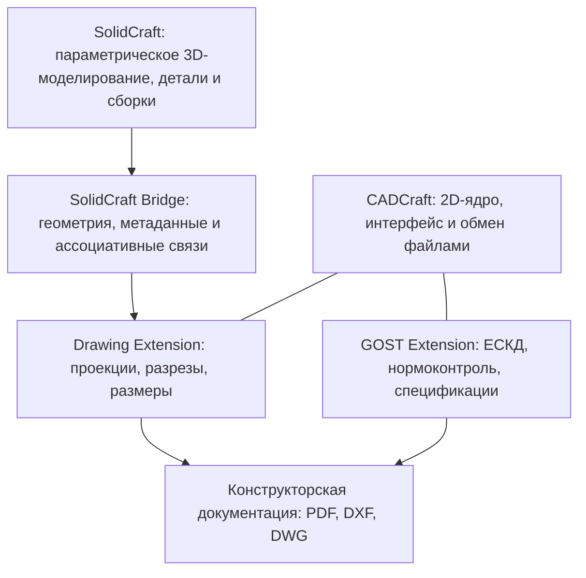

# План переработки и развития CADCraftGOST

**Проект:** [russian-cadcraft](https://github.com/mikiway902/russian-cadcraft)  
**Язык разработки:** Rust  
**Базовый проект:** [CADCraft](https://github.com/storytold/cadcraft)  
**Смежный проект:** [SolidCraft](https://github.com/tangency-labs/solidcraft)  
**Дата:** 19.11.2026

Исполнение и доказательства: [PROGRESS.md](PROGRESS.md). Текущая архитектура: [ARCHITECTURE.md](ARCHITECTURE.md).
Исторический roadmap базового CADCraft сохранён в [upstream](https://github.com/storytold/cadcraft/blob/11d66cc3cd6a3676aad79401c9d390f3ccbf3aa7/ROADMAP.md).

## 1. Концепция проекта

Создать открытую машиностроительную САПР на основе двух взаимосвязанных приложений, не дублирующих функциональность друг друга.



| SolidCraft | CADCraftGOST |
| --- | --- |
| Параметрическое 3D-моделирование | Двумерное проектирование |
| Создание деталей и сборок | Чертежи деталей и сборочные чертежи |
| Булевы операции, фаски и скругления | Проекции, разрезы и сечения |
| B-Rep-геометрия | Ассоциативные размеры |
| Расчёт массы и объёма при наличии необходимых данных | Спецификации, ЕСКД и нормоконтроль |

Главный принцип — максимально использовать существующий открытый код, не переписывать работающие компоненты и не создавать повторно существующие алгоритмы.

## 2. Основные архитектурные решения

| Решение | Статус |
| --- | --- |
| Переписывание CADCraft с нуля | Исключить |
| Модульная архитектура | Внедрить |
| Поддержка оригинальных обновлений | Обязательна |
| Разработка расширений на Rust | Обязательна |
| Поддержка будущего Plugin API | Предусмотреть |
| Собственное ядро 3D-моделирования | Исключить |
| Переиспользование SolidCore | Исследовать |
| Интеграция с SolidCraft | Реализовать |
| Работа без интернета | Обязательна |
| Поддержка ИИ-агентов через MCP | Сохранить и расширить |
| Кроссплатформенность | Сохранить |

На момент проверки в SolidCraft существуют модули чертежей, разрезов, ассоциативных размеров, спецификаций и геометрических ссылок; используется B-Rep-ядро SolidCore. Перед разработкой новых алгоритмов исследовать возможность переиспользования этих компонентов.

В оригинальном CADCraft пока отсутствует полноценный Plugin API для компилируемых плагинов. До его появления целевой вариант — модульный форк с подключением расширений на этапе компиляции и минимальными изменениями upstream. После появления официального API оценить миграцию расширений на него.

Источники: [CADCraft Customization](https://github.com/storytold/cadcraft/blob/main/docs/customization.md), [SolidCraft](https://github.com/tangency-labs/solidcraft), [модуль чертежей](https://github.com/tangency-labs/solidcraft/tree/main/crates/doc/src/drawing), [SolidCore](https://github.com/tangency-labs/solidcraft/tree/main/solidcore).

---

## 3. Полная дорожная карта разработки

Приоритеты: **P0** — критический, **P1** — высокий, **P2** — последующее развитие. Все пункты первоначально оставлены без отметок: уже существующие функции необходимо подтвердить аудитом и тестами, а не реализовывать повторно.

### Этап 0. Аудит и сохранение текущих наработок (P0)

- [x] Провести полный аудит изменений относительно оригинального CADCraft.
- [x] Создать резервную ветку текущей реализации.
- [x] Провести инвентаризацию всех добавленных функций.
- [x] Запустить полный набор существующих тестов.
- [x] Выявить заглушки, дублирование кода и регрессии.
- [x] Зафиксировать текущую производительность.
- [x] Сохранить все работоспособные функции ГОСТ.

### Этап 1. Переработка архитектуры (P0)

- [x] Вынести функциональность ГОСТ в отдельные Rust-модули.
- [x] Отделить интерфейс расширений от бизнес-логики.
- [x] Отделить нормоконтроль и спецификации.
- [x] Выделить модуль преобразования 3D в 2D.
- [x] Разработать минимальный интерфейс подключения расширений.
- [x] Предусмотреть регистрацию команд, меню и диалогов.
- [x] Предусмотреть события изменения документа и транзакционный Undo/Redo.
- [x] Обеспечить отключение расширений без нарушения работы CADCraft.
- [x] Исключить циклические зависимости между модулями.

### Этап 2. Синхронизация с оригинальным CADCraft (P0)

- [x] Подключить оригинальный репозиторий как upstream.
- [ ] Минимизировать изменения оригинальных файлов.
- [ ] Автоматизировать проверку upstream-обновлений.
- [ ] Автоматизировать сборку и тестирование после обновлений.
- [ ] Не объединять изменения автоматически при наличии конфликтов или ошибок.
- [ ] Предусмотреть откат на предыдущую стабильную версию.

### Этап 3. Завершение ребрендинга (P0)

- [ ] Удалить фирменные логотипы ArtCraft согласно лицензии.
- [ ] Создать собственные иконки и оформление.
- [ ] Исправить README и ссылки на скачивание.
- [ ] Разделить идентификаторы приложений и пакетов.
- [ ] Разделить каталоги настроек и пользовательских данных.
- [ ] Настроить собственный канал обновлений.
- [ ] Сохранить необходимые сведения об авторах и лицензиях оригинала.

### Этап 4. Интеграция с SolidCraft (P0)

- [x] Исследовать архитектуру SolidCore и модулей чертежей SolidCraft.
- [ ] Проверить лицензии, доступные API и возможность переиспользования кода.
- [x] Сравнить прямое подключение библиотек и взаимодействие через отдельный процесс.
- [ ] Разработать версионируемый протокол SolidCraft Bridge.
- [ ] Поддержать импорт STEP.
- [ ] Поддержать импорт IGES в пределах возможностей ядра.
- [ ] Реализовать загрузку собственных файлов SolidCraft либо получение геометрии через его API.
- [ ] Передавать структуру сборок, материалы и обозначения деталей.
- [ ] Реализовать обнаружение изменения исходной модели.
- [ ] Обеспечить возможность просмотра импортированной 3D-модели.

### Этап 5. Преобразование 3D-моделей в чертежи (P0)

- [ ] Реализовать точные ортогональные и изометрические проекции.
- [ ] Реализовать удаление скрытых линий.
- [ ] Поддержать аналитические кривые и силуэты поверхностей.
- [ ] Реализовать главные, дополнительные и местные виды.
- [ ] Реализовать простые, ступенчатые и ломаные разрезы.
- [ ] Реализовать вынесенные и наложенные сечения.
- [ ] Реализовать выносные элементы.
- [ ] Поддержать проекционные связи между видами.
- [ ] Реализовать штриховку сечений и сборочные исключения.
- [ ] Поддержать разные масштабы видов.
- [ ] Сохранить редактируемость сформированной 2D-геометрии.

### Этап 6. Ассоциативность (P0)

- [ ] Связать чертёж с исходной 3D-моделью.
- [ ] Реализовать устойчивые идентификаторы деталей, граней и рёбер.
- [ ] Привязывать размеры к точной геометрии, а не к полигональной сетке.
- [ ] Обновлять виды и разрезы при изменении модели.
- [ ] Сохранять пользовательские аннотации при перестроении.
- [ ] Обнаруживать потерянные и неоднозначные геометрические ссылки.
- [ ] Обновлять спецификации при изменении состава сборки.
- [ ] Поддержать ручное обновление и Undo/Redo.
- [ ] Обеспечить сохранение связей после повторного открытия проекта.

### Этап 7. Расширение поддержки ГОСТ и ЕСКД (P1)

- [ ] Проверить соответствие уже реализованных функций нормативным документам.
- [ ] Расширить поддержку основных надписей и дополнительных граф.
- [ ] Поддержать дополнительные форматы листов.
- [ ] Расширить размерные стили.
- [ ] Доработать допуски, посадки и предельные отклонения.
- [ ] Расширить обозначения резьб, сварки и шероховатости.
- [ ] Добавить обозначения покрытий и термообработки.
- [ ] Доработать обозначения баз и геометрических допусков.
- [ ] Реализовать управление изменениями документации.
- [ ] Добавить версионируемые профили нормативных требований.

### Этап 8. Нормоконтроль (P1)

- [ ] Расширить существующую проверку пересечений и наложений.
- [ ] Добавить проверку размерных цепей в пределах доступной геометрии.
- [ ] Проверять толщины и типы линий.
- [ ] Проверять размеры текста и оформление листов.
- [ ] Проверять заполнение основных надписей.
- [ ] Проверять корректность связей видов, размеров и позиций.
- [ ] Проверять согласованность спецификации со сборкой.
- [ ] Разделять ошибки, предупреждения и требования ручной проверки.
- [ ] Добавить переход к проблемному объекту.
- [ ] Оптимизировать анализ больших чертежей.
- [ ] Добавить экспорт отчёта нормоконтроля.

### Этап 9. Спецификации и стандартные изделия (P1)

- [ ] Доработать спецификации по ЕСКД.
- [ ] Получать состав изделия из сборки SolidCraft.
- [ ] Автоматически обновлять количества и позиции.
- [ ] Реализовать вложенные сборки и варианты исполнения.
- [ ] Создать библиотеку стандартных изделий.
- [ ] Добавить параметрические 2D-обозначения болтов, гаек, шайб, подшипников и других изделий.
- [ ] Поддержать расширяемую базу материалов.
- [ ] Добавить экспорт спецификаций в CSV и XLSX.

### Этап 10. Интерфейс и русификация (P1)

- [ ] Завершить русификацию интерфейса.
- [ ] Добавить полноценную панель инструментов ГОСТ.
- [ ] Добавить дерево листов, видов, разрезов и импортированных моделей.
- [ ] Создать редактор свойств инженерных обозначений.
- [ ] Добавить менеджер связанных 3D-моделей.
- [ ] Добавить панель нормоконтроля.
- [ ] Обеспечить настройку горячих клавиш.
- [ ] Сохранить возможность использования оригинального интерфейса без ГОСТ.

### Этап 11. Обмен файлами и печать (P1)

- [ ] Проверить сохранение и повторное открытие DXF.
- [ ] Проверить совместимость DWG в пределах поддерживаемых возможностей.
- [ ] Сохранить редактируемость размеров и обозначений при обмене.
- [ ] Обеспечить физически правильные размеры PDF при печати.
- [ ] Проверить кириллицу, шрифты и специальные символы.
- [ ] Добавить пакетный экспорт листов.
- [ ] Проверить многостраничные PDF.
- [ ] Предупреждать о возможной потере ассоциативных данных при экспорте.

### Этап 12. Производительность и надёжность (P1)

- [ ] Профилировать потребление оперативной памяти.
- [ ] Оптимизировать перестроение видов.
- [ ] Реализовать кеширование результатов проецирования.
- [ ] Перестраивать только изменённые виды и детали.
- [ ] Перенести тяжёлые вычисления в фоновые задачи.
- [ ] Предусмотреть отмену длительных операций.
- [ ] Проверить работу с крупными сборками.
- [ ] Добавить тестирование повреждённых и некорректных файлов.
- [ ] Не использовать GPU-ускорение без подтверждённой необходимости.

### Этап 13. Автоматизация и ИИ (P2)

- [ ] Сохранить существующие CLI, MCP и JSON API.
- [ ] Предоставить API всех новых команд ГОСТ.
- [ ] Обеспечить автоматическое создание чертежей из 3D-моделей.
- [ ] Обеспечить пакетный выпуск конструкторской документации.
- [ ] Добавить возможность программного нормоконтроля.
- [ ] Подготовить документацию и примеры автоматизации.
- [ ] Не добавлять обязательную зависимость от облачных нейросетей.

### Этап 14. Тестирование и выпуск (P0/P1)

- [ ] Настроить собственный GitHub Actions CI.
- [ ] Добавить модульные, интеграционные и регрессионные тесты.
- [ ] Добавить эталонные чертежи и модели.
- [ ] Настроить сборки для Linux, Windows и macOS.
- [ ] Подготовить RPM, DEB, AppImage и другие установщики.
- [ ] Проверить установку рядом с оригинальным CADCraft.
- [ ] Подготовить документацию пользователя.
- [ ] Опубликовать собственный Alpha-релиз после прохождения критериев приёмки.

> CI и автоматическое тестирование необходимо начать на этапе 0, не откладывая до завершения всей дорожной карты. Публикация релизов — после соответствующей приёмки.

---

## 4. Предлагаемая структура репозитория

```text
russian-cadcraft/
├── upstream/
│   └── cadcraft/
├── extensions/
│   ├── extension-api/
│   ├── gost-core/
│   ├── gost-ui/
│   ├── gost-standards/
│   ├── gost-normcontrol/
│   ├── gost-specification/
│   ├── gost-library/
│   ├── drawing3d/
│   └── solidcraft-bridge/
├── patches/
├── assets/
│   ├── fonts/
│   ├── icons/
│   ├── templates/
│   ├── materials/
│   └── standards/
├── tests/
│   ├── unit/
│   ├── integration/
│   ├── regression/
│   ├── reference-drawings/
│   ├── reference-models/
│   └── benchmarks/
├── packaging/
├── scripts/
├── docs/
├── .github/workflows/
├── Cargo.toml
├── AGENTS.md
├── ARCHITECTURE.md
├── ROADMAP.md
├── PROGRESS.md
└── CHANGELOG.md
```

Это целевая структура, а не требование механически переместить все файлы. Если существующая организация Cargo workspace позволит сделать интеграцию проще, её следует сохранить.

## 5. Варианты интеграции с SolidCraft

| Метод | Приоритет |
| --- | --- |
| Переиспользование открытых модулей проецирования SolidCraft | Высокий |
| Переиспользование SolidCore | Высокий |
| Взаимодействие через CLI или API | Высокий |
| Импорт STEP | Высокий |
| Импорт IGES | Средний |
| Обмен через DXF | Резервный |
| Импорт STL как источника точных чертежей | Исключить |

Оптимальный вариант следует выбрать после создания небольшого рабочего прототипа интеграции. Нет смысла подключать всё геометрическое ядро, если SolidCraft может предоставить необходимые точные проекции и геометрические измерения через программный интерфейс.

Обычный DXF недостаточен для полноценной ассоциативности: дополнительно необходимо передавать устойчивые идентификаторы геометрии и сведения об исходной модели. Возможности экспорта отдельных видов и целых листов следует проверять раздельно; не предполагать поддержку формата без проверки.

Переиспользовать только открытые компоненты, соблюдая лицензии. Фирменные ресурсы и отдельно лицензируемые компоненты интерфейса SolidCraft не переносить без соответствующего разрешения.

## 6. Нормативные документы

Создать расширяемую систему нормативных профилей, а не зашивать требования ГОСТ непосредственно в алгоритмы.

| Стандарт | Назначение |
| --- | --- |
| ГОСТ Р 2.104 | Основные надписи |
| ГОСТ Р 2.106 | Текстовые документы и спецификации |
| ГОСТ Р 2.109 | Основные требования к чертежам |
| ГОСТ 2.301 | Форматы |
| ГОСТ 2.302 | Масштабы |
| ГОСТ 2.303 | Линии |
| ГОСТ 2.304 | Чертёжные шрифты |
| ГОСТ 2.305 | Виды, разрезы, сечения |
| ГОСТ 2.306 | Графические обозначения материалов |
| ГОСТ 2.307 | Размеры и предельные отклонения |
| ГОСТ 2.308 | Допуски формы и расположения |
| ГОСТ 2.309 | Шероховатость |
| ГОСТ 2.311 | Изображение резьбы |
| ГОСТ 2.312 | Сварные соединения |
| ГОСТ 2.313 | Неразъёмные соединения |
| ГОСТ 2.316 | Надписи и технические требования |
| ГОСТ 2.320 | Размеры, допуски и посадки конусов |
| ГОСТ 2.503 | Внесение изменений |

Перед реализацией каждого профиля проверить действующие редакции, поправки, обозначения и даты вступления в силу. Данный перечень — план охвата, а не подтверждение актуальности всех редакций. Полное соответствие ЕСКД нельзя объявлять исключительно по результатам автоматических тестов.

## 7. Контрольные модели для проверки

| Эталонное изделие | Что проверять |
| --- | --- |
| Ступенчатый вал | Диаметры, радиусы, фаски, резьбы, посадки |
| Корпус подшипника | Отверстия, разрезы, допуски, шероховатость |
| Рабочее колесо ЦБК | Сложные криволинейные поверхности и проекции |
| Лопатка турбины | Профили, пространственная геометрия и сечения |
| Сборка газотурбинного двигателя | Сборочные чертежи, спецификации, позиции и производительность |

На этих моделях проверять не только формальную работоспособность функций, но и пригодность программы для реальных инженерных задач. Для каждого сценария сохранить исходную модель, эталонные результаты, допустимые отклонения и результаты проверок.

## 8. План выпуска версий

Номера ниже — условные обозначения этапов развития форка, а не обязательная замена текущей версии upstream. Окончательную схему версионирования выбрать так, чтобы не нарушить работу установщиков и автообновления.

| Версия | Название | Содержание |
| --- | --- | --- |
| v0.1 | Modular Alpha | Модульная архитектура, сохранение текущих функций, ребрендинг, CI/CD |
| v0.2 | SolidCraft Integration | Импорт 3D, точные проекции, виды и разрезы |
| v0.3 | Associative Drafting | Ассоциативные размеры, автоматическое перестроение чертежей |
| v0.4 | Engineering Standards | Расширенная поддержка ГОСТ, нормоконтроль и стандартные изделия |
| v0.5 | Assembly Documentation | Сборочные чертежи и автоматические спецификации |
| v0.9 | Beta | Оптимизация, стабильность, обмен файлами и полное регрессионное тестирование |
| v1.0 | Stable | Выпуск после подтверждения работоспособности на реальных инженерных проектах |

## 9. Что категорически не нужно разрабатывать

- Собственный параметрический 3D-редактор.
- Собственное твердотельное ядро с нуля.
- Редактор трёхмерных сборок.
- Собственный движок рендеринга взамен существующего.
- Дублирующие реализации алгоритмов SolidCraft.
- Полное переписывание CADCraft.
- Копирование закрытых компонентов КОМПАС-3D.

## 10. Правила работы ИИ-агентов над проектом

- Работать непрерывно до выполнения поставленной задачи в пределах предоставленного доступа и ресурсов.
- Вести актуальные `ROADMAP.md`, `PROGRESS.md`, `ARCHITECTURE.md`.
- Искать готовые открытые реализации перед написанием собственных алгоритмов.
- Не удалять работающую функциональность без равноценной замены.
- Не использовать заглушки и фиктивные результаты.
- Не считать задачу завершённой без проверки.
- Запускать регрессионные тесты после каждого значимого изменения.
- Параллельно выполнять независимые задачи.
- Самостоятельно устранять обнаруженные ошибки.
- Фиксировать результаты небольшими логическими коммитами.
- Не останавливаться для промежуточных согласований, кроме действительно блокирующих решений.

### Критерии приёмки задач

- Реализация подключена к приложению и доступна по предусмотренному интерфейсу.
- Выполнены подходящие модульные, интеграционные и регрессионные проверки; результаты зафиксированы.
- Для геометрии проверены точность, единицы измерения и граничные случаи.
- Для изменений документа проверены сохранение, повторное открытие и Undo/Redo, где применимо.
- Для изменений GUI проверен реальный пользовательский сценарий.
- Ограничения и неподдерживаемые сценарии явно документированы; ошибки не маскируются.
- Чек-лист обновлён только после фактической приёмки. Неисполненные проверки отмечены отдельно.

---

## Итоговая цель

Не создавать ещё одну САПР с нуля, а разработать открытую экосистему машиностроительного проектирования с полноценной поддержкой ЕСКД: SolidCraft отвечает за 3D-моделирование, CADCraftGOST — за точное преобразование моделей в чертежи и выпуск конструкторской документации.

Когда в оригинальном CADCraft появится официальный Plugin API, желательно перейти от поддержки собственного форка к распространению независимых расширений, если API обеспечивает необходимые возможности. До этого момента оптимальный подход — модульный форк с минимальными изменениями оригинального приложения.
